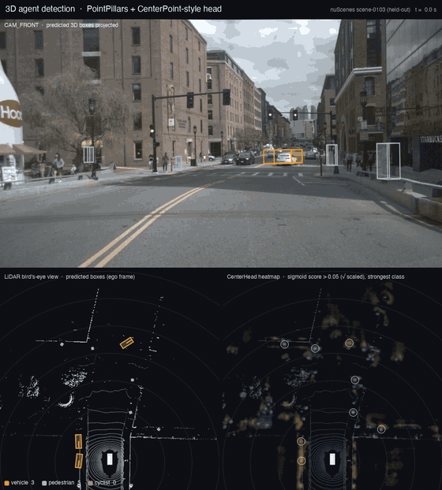

# Hybrid Scene Encoder for Autonomous Driving



*Held-out nuScenes scene-0103. Top: front camera with the predicted 3D boxes projected into it. Bottom left:
LiDAR bird's-eye view with boxes. Bottom right: the CenterHead heatmap (where the model "sees" object centers).*

## Current results (nuScenes-mini)

LiDAR-only 3D detection of vehicles, pedestrians and cyclists: 4-DoF pose (x, y, z, yaw) + 3D size per agent.
Trained on the 8 `mini_train` scenes, evaluated on the 2 held-out `mini_val` scenes with center-distance AP (2 m).

| Model | mAP | Vehicle AP | Pedestrian AP |
|---|---|---|---|
| v1: single-scale backbone | 0.123 | 0.280 | 0.088 |
| v2: multi-scale backbone, 9-feature pillars, normalized targets, augmentation | **0.196** | **0.430** | **0.149** |

The full story, from downloading the data to these results (coordinate frames, the model, bugs found, the
Apple-GPU memory leak, evaluation and known weaknesses), is in
[docs/PROJECT_WALKTHROUGH.md](docs/PROJECT_WALKTHROUGH.md).

```bash
.venv/bin/python train.py                                    # train (Hydra config in configs/)
.venv/bin/python render_demo.py --ckpt <best.ckpt> --scene scene-0103 --score 0.3,0.4,0.4   # demo video + GIF
```

## Overview

This project implements a **Hybrid Scene Encoder** for autonomous driving, designed to learn rich, scalable scene representations by **combining geometric, semantic, and temporal information** from multiple modalities.

The encoder serves as a **foundational perception–scene understanding module**, suitable for downstream tasks such as:

* Behavior prediction
* Motion planning
* Incident detection and forensics
* Trajectory forecasting
* Scene-level reasoning

Rather than relying on a single representation (e.g., raw point clouds or BEV grids), this project integrates **pillar-based LiDAR encoding**, **agent-centric features**, and **scene-level context** into a unified latent representation.

---

## Key Idea

> **Encode the driving scene using complementary inductive biases rather than a single modality.**

The hybrid encoder is built around the observation that:

* LiDAR point clouds provide precise geometry
* BEV grids enable scalable convolutional reasoning
* Agent-centric and temporal features capture interactions and behavior
* Learned embeddings outperform hand-crafted scene abstractions

This project explores how to **combine these representations efficiently and coherently**.

---

## Architecture Overview

At a high level, the pipeline consists of:

```
Raw Sensor Inputs
 (LiDAR, ego state, agents)
        ↓
Pillarization & Point Encoding
        ↓
BEV Feature Construction
        ↓
Hybrid Scene Encoder
 (Geometric + Contextual Fusion)
        ↓
Scene Latent Representation
```

### Core Components

#### 1. Pillar-Based LiDAR Encoder

* Converts raw LiDAR point clouds into **x–y pillars**
* Encodes per-pillar geometry using a **PointNet-style encoder**
* Produces a sparse set of pillar embeddings that are scattered into a BEV feature map

#### 2. BEV Spatial Backbone

* Processes the pseudo-image using efficient **2D convolutions**
* Captures local and global spatial context
* Enables scalable scene-level reasoning

#### 3. Hybrid Feature Fusion

* Combines:

  * Geometric features from LiDAR
  * Ego-vehicle state
  * Agent-level motion cues (when available)
* Outputs a unified **scene embedding** suitable for downstream models

---

## Why a Hybrid Encoder?

Traditional pipelines often suffer from one of the following limitations:

* Point-based methods lack scalability
* Grid-based methods lose fine-grained geometry
* Hand-designed scene abstractions do not generalize

This hybrid approach provides:

* **Geometric fidelity** via point-level encoding
* **Computational efficiency** via BEV representations
* **Flexibility** for multi-task and multi-head learning
* **Interpretability** through spatially grounded features

---

## Input Representation

* **LiDAR**: `(N, 4)` → `(x, y, z, intensity)`
* **Pillarized representation**: `(P, T, F)`

  * `P`: number of non-empty pillars
  * `T`: max points per pillar
  * `F`: per-point feature dimension

After encoding:

* BEV feature map: `(C, H, W)`
* Scene latent embedding: `(D,)` or `(D, H', W')` depending on configuration

---

## Output

The encoder produces a **scene-level latent representation** that can be:

* Consumed by prediction or planning models
* Used for offline analysis and incident mining
* Extended with task-specific heads (classification, regression, trajectory decoding)

---

## Design Goals

* **Scalable**: Efficient for large-scale datasets and fleet-level deployment
* **Modular**: Easy to extend with new modalities or heads
* **Production-oriented**: Fixed-size tensors, batch-friendly, GPU-efficient
* **Research-friendly**: Clean abstractions for experimentation

---

## Use Cases

* Autonomous vehicle behavior modeling
* Scene understanding and representation learning
* Incident detection and failure mode analysis
* Multi-modal trajectory prediction
* Simulation and closed-loop evaluation pipelines

---

## Future Extensions

* Temporal scene encoding across multiple LiDAR frames
* Attention-based fusion instead of purely convolutional fusion
* Integration with camera-based BEV features
* Joint behavior and motion decoding heads

---

## Summary

This project implements a **hybrid scene encoder** that bridges raw sensor data and high-level driving intelligence. By combining pillar-based LiDAR encoding with BEV-based spatial reasoning, it provides a strong and extensible foundation for modern autonomous driving systems.

